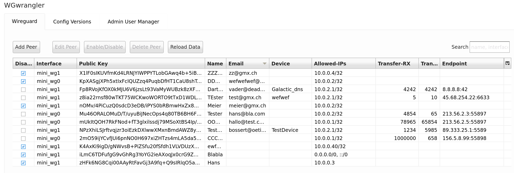
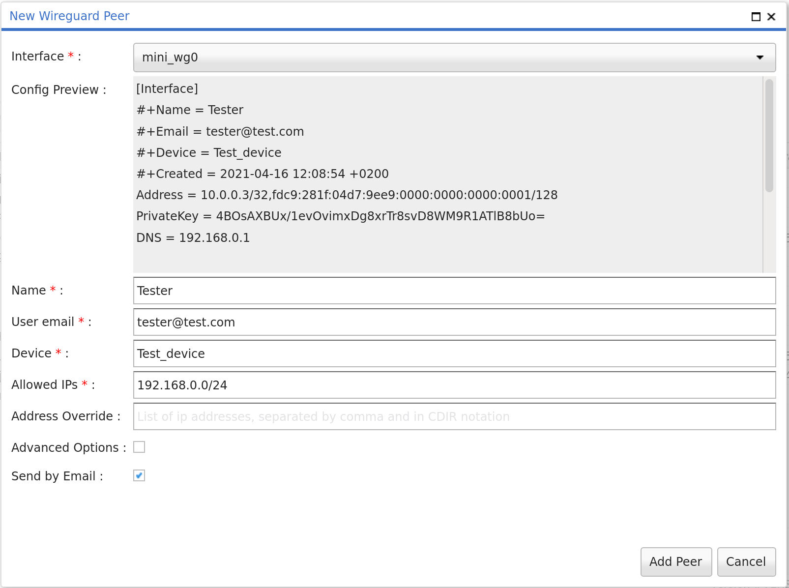
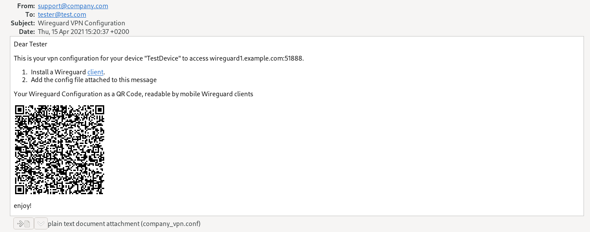

WGwrangler
===========

[](https://github.com/oposs/wg-wrangler/actions/workflows/ci.yml)
[](https://github.com/oposs/wg-wrangler/releases/latest)

WGwrangler is a web application to manage local Wireguard Configuration using 
[wg-meta](https://metacpan.org/release/Wireguard-WGmeta) in its backend. 



Install
-------

Debian 12 and 13, Ubuntu 22.04, 24.04 and 26.04:

```sh
sudo install -d -m 0755 /etc/apt/keyrings
sudo curl -fsSL -o /etc/apt/keyrings/gitea-oposs.asc https://gitea.oetiker.ch/api/packages/oposs/debian/repository.key
echo "deb [signed-by=/etc/apt/keyrings/gitea-oposs.asc] https://gitea.oetiker.ch/api/packages/oposs/debian $(. /etc/os-release && echo $VERSION_CODENAME) main" | sudo tee /etc/apt/sources.list.d/oposs.list
sudo apt update && sudo apt install wg-wrangler
```

The packages and the source tarball are also attached to each
[release](https://github.com/oposs/wg-wrangler/releases/latest).
"Installation (deb package)" below describes what the package sets up.

Installation from source
------------------------

Download the source tarball of the current release

```console
# Install os dependencies
sudo apt install build-essential libqrencode-dev libssl-dev zlib1g-dev \
                 pkg-config gettext libnet-idn-encode-perl

./configure --disable-container --prefix=$HOME/opt/wgwrangler
make
```

**Minimum Node.js: `v20` -> If no compatible node version is found, the frontend is not built!**

Configure will check if all requirements are met and give
hints on how to fix the situation if something is missing.

Any missing perl modules will be downloaded and built.

To install the application, just run

```console
make install
```

You can now run wgwrangler in reverse proxy mode.

```console
cd $HOME/opt/wgwrangler/bin
./wgwrangler prefork
```

OS Preparation (after manual installation)
-------------

Since managing wireguard using its associated `wg*` commands requires root privileges we suggest the following
setup:

- Create a separate user/group e.g `wireguard_manager`
- Whitelist the `wg` commands for this group in the `/etc/sudoers` file:
  ```text
  %wireguard_manager ALL=NOPASSWD: /usr/bin/wg*
  ```
- Set `wireguard_manger` as group on `/etc/wireguard` and adjust permissions to `g+rwx`
- Additionally, creating a `wg-wrangler.service` file may improve usability quite a bit:
  ```text
  # This is to be considered as a (very) simple example of such a .service file
  [Unit]
  Description=wg-wranger wireguard manager
  
  [Service]
  Type=simple
  User=wireguard_manager
  Group=wireguard_manager
  ExecStart=/usr/bin/perl /home/wireguard_manager/opt/wgwrangler/bin/wgwrangler prefork --listen 'http://127.0.0.1:7171'
  
  [Install]
  WantedBy=multi-user.target
   ```

If you enable `enable_git`, git runs as this account against `/etc/wireguard`.
Unless the repository belongs to the account itself, git refuses to touch it
with `detected dubious ownership`. Declare the directory as safe in the
account's `~/.gitconfig`, meaning the home directory recorded in `/etc/passwd`,
since that is where git looks:

```text
[safe]
directory = /etc/wireguard
```

Installation (deb package)
--------------------------

The steps described in the manual installation section are done automatically when you install one of the provided `.deb` packages.
Configuration resides in `/etc/opt/wg-wrangler`.

The package creates the system account `wg-wrangler_manager` with
`/opt/wg-wrangler/home` as its home directory, and maintains the `.gitconfig`
described above in there. If you set the machine up by hand first and created
an account of that name yourself, the package keeps it as it is: it never
changes the home directory of an existing account. Should that home point
somewhere else, git will not find the `.gitconfig` the package writes, because
it reads the home directory from `/etc/passwd`. Point the account at the
expected location once:

```console
sudo systemctl stop wg-wrangler
sudo usermod -d /opt/wg-wrangler/home wg-wrangler_manager
sudo systemctl start wg-wrangler
```

This does not move any files. Reinstalling the package afterwards recreates
the `.gitconfig` in the right place. A leftover `.gitconfig` in the previous
home is no longer read and can be removed.

Currently supported distributions:

- Ubuntu 22.04 LTS
- Ubuntu 24.04 LTS
- Ubuntu 26.04 LTS
- Debian 12 (bookworm)
- Debian 13 (trixie)

The package ships a `wg-wrangler.service` unit but does **not** enable it, because
there is no usable configuration yet at that point. Create the configuration as
described below, then activate the service:

```console
sudo systemctl enable --now wg-wrangler
```

Configuration
-------------

Do get started, rename `/etc/opt/wg-wrangler/wgwrangler.dist.yaml` to `/etc/opt/wg-wrangler/wgwrangler.yaml` and adjust
according your needs. Make sure to change `sesame_user` and `sesame_pass`, the
shipped defaults are publicly known.

Development
-----------

While developing the application it is convenient to NOT have to install it
before runnning. You can actually serve the Qooxdoo source directly
using the built-in Mojo webserver.

```console
./bin/wgwrangler-source-mode.sh
```

You can now connect to the CallBackery app with your web browser.

If you need any additional perl modules, add them to the `cpanfile` and run
./bootstrap.

**Honored Environment Variables**

- `WGwrangler_NO_WG`: If defined, no wg* command is called, for example to generate public and private keys.
- `WGwrangler_CONFIG_HOME`: Use this variable to set the path to the main configuration files (email template + main config)

Testing
-------

`./configure` defaults to container mode: `make` builds the image the
`Containerfile` describes with podman or docker, and `make check` runs the
test suite in it. `make test-dev TARGET=t/basic.t` runs one test against the
`lib` and `t` of the working tree. `./configure --disable-container` builds and
tests in this tree instead, with the dependencies listed above.

Releasing
---------

Add an entry for every change under `## [Unreleased]` in `CHANGES.md`. To
release, run the **Create release PR** workflow in the GitHub Actions tab
(bugfix, feature or major). It sets `VERSION`, builds the source tarball and
the five `.deb` packages, runs the tests and opens a pull request. Merging
that pull request tags the release, publishes it and uploads the packages to
the apt repository.

To make sure the project builds with the oldest perl among the build targets,
currently 5.34 on ubuntu 22.04, set the `PERL` environment variable to such an
interpreter, delete any `PERL5LIB` environment variable, and run
`make clean && make` in a tree configured with `--disable-container`. This
writes a `thirdparty/cpanfile-5.34.snapshot`, which the tarball carries and
the build uses to install the same module versions.

Build deb package locally
-------------------------

```shell
cd wg-wrangler
podman run --rm -v $(pwd):/mnt -it ubuntu:24.04 /mnt/build_local.sh
```

The package for that distribution lands in the source tree.

Screenshots
-----------






Enjoy!

Tobias Bossert <bossert _at_ oetiker _this_is_a_dot_ ch>
